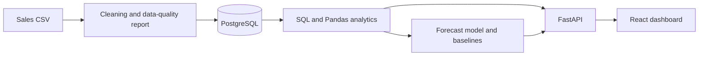

# SalesCast

**A sales analytics and forecasting dashboard that turns historical orders into a planning range for the months ahead, and says plainly how far that range can be trusted.**

> **About the data:** the bundled dataset (`data/sales.csv`) is **synthetic**. It was generated by `scripts/generate_sales_data.py` with a fixed random seed. It is not real company data, and every figure in this document describes that generated dataset. The pipeline works on any CSV with the same columns.

**Stack:** React, TypeScript, Vite, Tailwind CSS, Recharts · Python, FastAPI, Pandas, NumPy, statsmodels · PostgreSQL

---

## The idea

Stock bought too early ties up cash; stock bought too late means lost sales. A forecast helps only if the person reading it knows how much to rely on it. Most dashboards draw a line and stop there.

SalesCast treats the forecast as the last step of a chain of evidence, not as a standalone chart:

1. **Clean** the raw orders and report what was wrong with them.
2. **Describe** what happened: revenue, products, regions, trend, seasonality.
3. **Forecast** the next 3, 6 or 12 months with a prediction interval.
4. **Test** the forecast on months the model never saw, against simple baselines.
5. **Advise** what management should prepare for, with the evidence behind each recommendation.

The guiding rule is *no claim without evidence*. Seasonality, forecasts and recommendations only appear when the data supports them, and each one states what it is based on. When the data is too thin, the app says so instead of guessing.

## Who it is for

A sales or operations manager who needs to answer questions like these without a data analyst on call:

| Question | Where it is answered |
|---|---|
| How much revenue has been generated, and how is it changing? | Key figures, sales overview |
| Which categories, products and regions perform best? | Category and region breakdowns, products |
| Is there a seasonal pattern, and is performance rising or falling? | Seasonality and trend |
| What are expected sales for the next 3, 6 or 12 months? | Sales forecast |
| How accurate is the model, and does it beat a simple rule? | Forecast accuracy |
| What should we prepare for? | Insights, recommendations, inventory signal |

Filters (date range, category, product, region) apply to the whole page. A filtered forecast is always labeled **Filtered**, never **Overall**, so a slice of the business is never mistaken for the whole.

## How it works



- **Backend (FastAPI):** loads and cleans the data once, runs the aggregation in SQL, and does the time-series work in Pandas and statsmodels. Forecast results are cached per filter-and-horizon combination, so the forecast, accuracy and insights views share one model fit.
- **Frontend (React):** a single-page dashboard. Every chart has a table view, series are distinguished by more than colour, there are light and dark themes, and the page can be saved as a PDF report.
- **Database (PostgreSQL):** holds the cleaned orders. The dashboard never reads the CSV directly.

### Where it runs

The project is built to run as three independent pieces: the **React site** on Vercel, the **FastAPI service** on Render, and **PostgreSQL** on Neon. The site calls the API directly; the API is told which website origin to trust. Locally, Docker Compose runs the same three pieces together. Configuration (database connection, allowed origin, API address) comes from environment variables, so the same code runs in both setups. See `render.yaml` and `frontend/vercel.json`.

## Data

`data/sales.csv`: 19,243 orders from January 2022 to December 2025, with 24 products, 3 categories (Technology, Furniture, Office Supplies) and 4 regions (West, East, Central, South).

| Column | Meaning |
|---|---|
| `order_id`, `order_date` | Order identifier and date |
| `product`, `category`, `region` | What was sold and where |
| `quantity`, `unit_price`, `discount` | Order details (discount is a fraction, 0 to 1) |
| `sales` | `quantity × unit_price × (1 − discount)` |
| `profit` | Sales minus a fixed cost model per category (optional) |

The generator builds in a moderate upward trend (about 8% a year), a yearly seasonal shape with a November and December peak and a January and February dip, and random noise. It also adds **15 duplicate orders and 10 missing discount values on purpose**, so the cleaning step has real problems to find. Profit comes from a simple cost model, so profit figures demonstrate the analysis and say nothing about real margins.

The pipeline works on any CSV with the required columns. If `profit` is missing, the profit section is left out.

## Data cleaning

Rows are only dropped for a documented reason, and every step is counted so the data-quality summary reflects what actually happened.

1. Trim text, parse dates and convert numbers (anything unparseable becomes missing).
2. Remove rows with invalid dates, missing order IDs, missing product, category or region, **duplicate orders** (first kept), non-positive quantities or prices, negative sales, or discounts outside 0 to 1.
3. **Recover missing discounts** from the order's own numbers: `discount = 1 − sales / (quantity × unit_price)`.
4. Check that `sales` agrees with `quantity × unit_price × (1 − discount)` and report any mismatches. Mismatches are reported, never silently changed.

Result on the bundled dataset:

```text
Records:                  19,243
Missing values:           10   (all in discount, all recovered)
Duplicate orders:         15   (removed)
Invalid dates:            0
Records after cleaning:   19,228
Sales formula mismatches: 0
```

The same summary is shown at the bottom of the dashboard, so a reader can see what was changed before trusting the numbers.

## Exploratory analysis

Historical figures are computed from the data, never hardcoded:

- **Key figures:** total revenue, orders, units, average order value, average monthly revenue, best-selling product, best region, and profit with margin.
- **Revenue, units and orders over time** by month, quarter or year. Monthly revenue also shows a 3-month moving average and a fitted trend line.
- **Category, region and product breakdowns.** The product view deliberately compares *top by revenue* with *top by units*, because the best seller by volume is not always the one that earns the most.
- **Seasonality:** average revenue by calendar month, each year overlaid month by month, quarter shares, and yearly growth.
- **Partial months** (for example, when a date filter cuts a month in half) are flagged and left out of the trend and seasonality, so they never look like a sales drop.

**Seasonality is only claimed when the data supports it.** It requires at least 24 complete months; calendar month must explain at least 50% of the variation around the trend (measured on revenue per day, so short months do not create a false pattern); and the best and worst months must differ by at least 15%. Otherwise the dashboard says no pattern is claimed and explains why. A test confirms that random noise is not reported as seasonal.

## Forecasting method

1. **Monthly series:** daily sales are aggregated to complete months. Partial months at either end are excluded.
2. **Model:** Holt-Winters style exponential smoothing (`ETSModel` in statsmodels) with a damped additive trend. A 12-month seasonal component is added **only if** the seasonality check passed and the training window holds at least two full years. It tries a multiplicative seasonal form first, then additive, then none, and reports which one it used and why.
3. **Train/test split:** the history is split in time order, 80% for training and the most recent 20% (at least 3 months) for testing. The model is fitted on the training months and scored on the test months it has never seen.
4. **Refit and forecast:** after scoring, the model is refit on all complete months and forecasts the next **3, 6 or 12 months** (default 6).
5. **Prediction intervals:** each forecast month has an 80% interval. The chart shows actual history as a solid line, the forecast as a dashed line inside a shaded future zone, and the interval as a band.
6. **Guard rails:** with fewer than 18 complete months the app refuses to forecast and says why. Forecast values are clipped at zero.

## Model evaluation

On the held-out test months, Holt-Winters is compared with two baselines:

| Model | What it does |
|---|---|
| Naive | Repeats the last observed month |
| Seasonal naive | Uses the same month one year earlier |

The seasonal baseline matters: on data with a yearly cycle, plain naive is easy to beat, so the model also has to beat a simple "same month last year" rule to be worth using.

| Metric | Meaning |
|---|---|
| **MAE** | Average size of the monthly miss, in revenue units |
| **RMSE** | Like MAE, but large misses count more |
| **MAPE** | Average miss as a percentage of actual revenue |
| **Interval coverage** | Share of test months that fall inside the 80% interval |

The dashboard prints a plain-language verdict, including *"did not beat the naive baseline"* when that happens. The scores for any given selection are shown live in the Forecast accuracy section.

**Limitations.** The test window is short (about 10 months on the bundled data), so error figures are noisy. Past accuracy does not guarantee future accuracy. The model uses sales history only, so promotions, price changes and outside events are not modeled. Forecasts cover total revenue for the current selection; there are no product-level forecasts.

## Business findings

These describe the **synthetic** dataset and show the kind of conclusions the dashboard produces. Each one is recomputed from whatever data is loaded.

- **Revenue:** $6.63M across 19,228 orders, an average order of $344.59 and about $138k a month.
- **Category mix:** Furniture earns 51% of revenue, Technology 33% and Office Supplies 16%. Office Supplies has the most units but the lowest revenue share, which is why volume and revenue need separate rankings.
- **Products:** Laptop earns the most revenue; Whiteboard sells the most units.
- **Regions:** West is the strongest region; South contributes 18.5% of revenue, more than 20% below the average region.
- **Seasonality:** a clear yearly pattern. Calendar month explains about 74% of the variation around the trend. November and December run roughly 26 to 28% above a typical month; January and February run about 16 to 23% below.
- **Trend:** the long-run trend is upward, about 9% a year. However, the most recent full year is flat against the year before, because average order value dipped even as order counts kept growing.
- **Furniture** revenue fell about 3% over the last 12 months compared with the 12 before.
- **Profit:** a 27.8% overall margin; Office Supplies has the highest margin (36.3%) despite the lowest revenue.

## Recommendations

The dashboard generates recommendations from the analysis and shows the evidence for each. Typical ones:

- **Build stock ahead of months that both the forecast and the history show as strong** (here, November and December).
- **Expect softer demand in historically weak months** (here, January and February) and avoid over-ordering for them.
- **Monitor categories with declining revenue** (here, Furniture).
- **Review underperforming regions** (here, South).
- **Use the forecast as a planning range, not a target,** and lean on last year's same-month sales whenever a simple baseline matched the model.

The inventory section only flags months expected to be at least 10% above or below the recent monthly average. It is informational and is not an inventory optimization system.

## The API

The dashboard is a thin client over a small read-only API. Every data endpoint accepts the same filters (`date_from`, `date_to`, `category`, `product`, `region`), which is how one filter bar controls the whole page.

| Endpoint | Returns |
|---|---|
| `/api/filters` | Dropdown values and the data's date range |
| `/api/dashboard` | Key figures, and whether filters are active |
| `/api/categories`, `/api/regions` | Revenue, units, orders and share of revenue |
| `/api/products` | Product table and top / lowest lists |
| `/api/trends` | Time series, trend and seasonality, by month, quarter or year |
| `/api/sales` | The order table, with search, sorting and paging |
| `/api/forecast` | Forecast, intervals and scope label |
| `/api/forecast/accuracy` | Held-out metrics and baseline comparison |
| `/api/insights` | Insights, recommendations and inventory signal |
| `/api/data-quality` | Cleaning summary |
| `/api/health` | Liveness check and loaded row count |

## Project structure

```text
salescast/
├── frontend/            React + TypeScript + Tailwind + Recharts
│   └── src/             components, charts, pages, services, lib (tested logic)
├── backend/
│   ├── app/
│   │   ├── api/         FastAPI routes
│   │   ├── analytics/   cleaning, SQL queries, trends and seasonality
│   │   ├── forecasting/ model, insights and recommendations
│   │   └── database/    schema, connection, loader
│   └── tests/           analytics, cleaning and forecasting checks
├── data/                synthetic dataset
├── scripts/             dataset generator
├── docker-compose.yml   local stack: database, API, website
└── render.yaml          hosted API definition
```

## Design decisions

- **Correct analysis over fancy modeling.** One primary model, with baselines to prove it adds value.
- **No claim without evidence.** Every insight names its basis; thin data produces a refusal, not a guess.
- **Show the work.** Cleaning steps, test-set scores and interval coverage are on the page, not hidden in a notebook.
- **Aggregation in SQL,** time-series and statistics in Pandas and statsmodels.
- **Logic is testable without infrastructure.** The analytics, cleaning and forecasting checks run against plain Pandas, with no database needed; the frontend's formatting and chart-data logic has its own tests.
- **Accessible by default.** Table views for every chart, non-colour cues, light and dark themes, and a print layout for sharing as a PDF.
- **Same code everywhere.** Environment variables, not code changes, separate a laptop from a hosted deployment.

## Limitations and future work

SalesCast is a demonstration of a careful analysis pipeline on synthetic data, not a production planning system. It forecasts total revenue only, from sales history alone, and the hosted free tiers it targets sleep when idle.

Natural next steps:

- Product-level forecasting
- Several forecasting models compared on the same test window
- Automated retraining when new data arrives
- More advanced inventory planning
